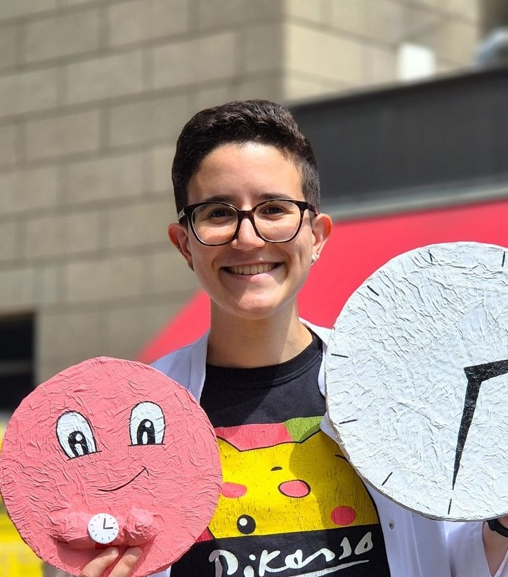

<!--Research story-->

::: {.about-me}
<figure class="about-me-figure">
  
  <figcaption class="photo-credit">© Tanio Calabrese</figcaption>
</figure>

::: {.about-me-text}
I am a PhD student at [Charité – Universitätsmedizin Berlin](https://www.charite.de/en/), where I study how the clocks inside our cells relate to human health.

In the [Buchauer Lab](https://buchauer-lab.eu/), I develop computational methods to infer the internal time of individual cells. By combining biological insight with computational approaches, I aim to understand how cells fall out of sync and what role this desynchronization may play in disease.

My path into research began during medical school at the [University of Pavia](https://en.unipv.it/en), Italy, where I complemented my clinical training with international research experiences in mitochondria, metabolism and, finally, chronobiology. After graduating as a medical doctor, I chose to dedicate myself fully to research, which led me to pursue a PhD. Medicine, however, taught me to ask biological questions with an eye on what they mean for patients, so bringing my findings from bench to bedside remains a goal close to my heart.

Beyond the lab, I am a passionate science communicator. I love sharing the wonders of science with [different formats of scientific outreach](scicomm.qmd).
:::
:::
