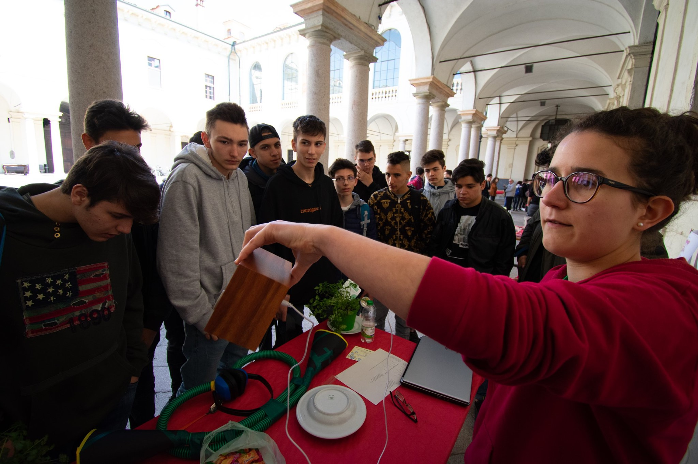

## Science Communication 

I strongly believe that doing good science is just as important as sharing it with the public. As a science communicator, I experiment with different formats to share scientific knowledge. 
<br>

### Science fairs

<div style="overflow: auto;">



<p>
This is the format I started with, while a students at the University of Pavia (in another hair-era), demonstrating experiments connected with the human body for the student-organized fair Indiscienza. I then organized a workshop for Italian kids in Cologne with Indiscienza and I am engaged with the Kinderuni.
</p>

</div>

### Videos

We tried it only once with friends. But others to come soon! 

[Stop motion about antibiotic resistance](https://youtu.be/xVcE1aprsjQ)
Italian only. Same people as before (science fair)

### Science Slams

These are science slams because there is the video. But I have been involved in a lot of other things, from skype a scientist, pub talks. Let me know if you would like to speak me at an event. 

```{=html}
<div class="video-gallery">

  <div class="video-tile">
    <iframe src="https://www.youtube.com/embed/xUwFYeNcl9o?si=7T0_nnl81HaNdWrq"
      allow="accelerometer; autoplay; clipboard-write; encrypted-media; gyroscope; picture-in-picture"
      allowfullscreen>
    </iframe>
  </div>
  
  <div class="video-tile">
    <iframe src="https://www.youtube.com/embed/-FFBiwrFrwg?si=RafmJWI7U_SyubiR"
      allow="accelerometer; autoplay; clipboard-write; encrypted-media; gyroscope; picture-in-picture"
      allowfullscreen>
    </iframe>
  </div>
  
  <div class="video-tile">
    <iframe src="https://www.youtube.com/embed/911BPimobVM?si=sKJA2AejObatw8Cp"
      allow="accelerometer; autoplay; clipboard-write; encrypted-media; gyroscope; picture-in-picture"
      allowfullscreen>
    </iframe>
  </div>
  
</div>
```

### Illustrations

Below you can find a selection of illustrations I've created for different projects, both with analogical medium, and digital and vector based.
<br><br>
Contact me if you are interested in a **custom commission** (graphical abstracts, favicons, logos, or visuals for websites and talks). 

```{=html}
<div class="modular-gallery">
  
  
  
  
  
</div>
```

<br><br>
© Roberta Colapietro, 2026. All works in this page are licensed under a [Creative Commons Attribution-NonDerivative-NonCommercial 4.0 International License](https://creativecommons.org/licenses/by-nc-nd/4.0). <br> This means you’re welcome to share anything from this page for non-commercial purposes as long as you credit me as the creator!

<div id="img-popup" class="img-popup hidden">
  <p>
    Want a high-res version or a custom illustration?<br>
    <a href="contact.qmd">Contact me here️!</a>
  </p>
  <span class="close-popup">×</span>
</div>

<script>
  const popup = document.getElementById("img-popup");
  const closeBtn = document.querySelector(".close-popup");

  document.addEventListener("contextmenu", function(e) {
    if (e.target.tagName === "IMG") {
      e.preventDefault();
      popup.classList.remove("hidden");
    }
  });

  closeBtn.addEventListener("click", function() {
    popup.classList.add("hidden");
  });

  document.addEventListener("click", function(e) {
    if (!popup.contains(e.target)) {
      popup.classList.add("hidden");
    }
  });
</script>