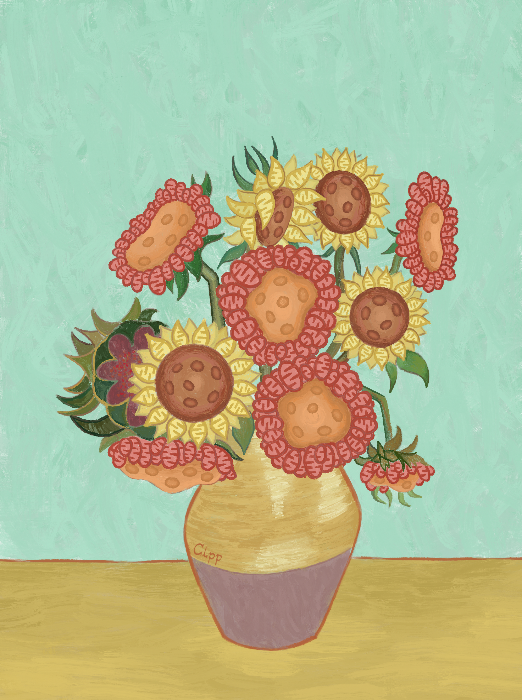
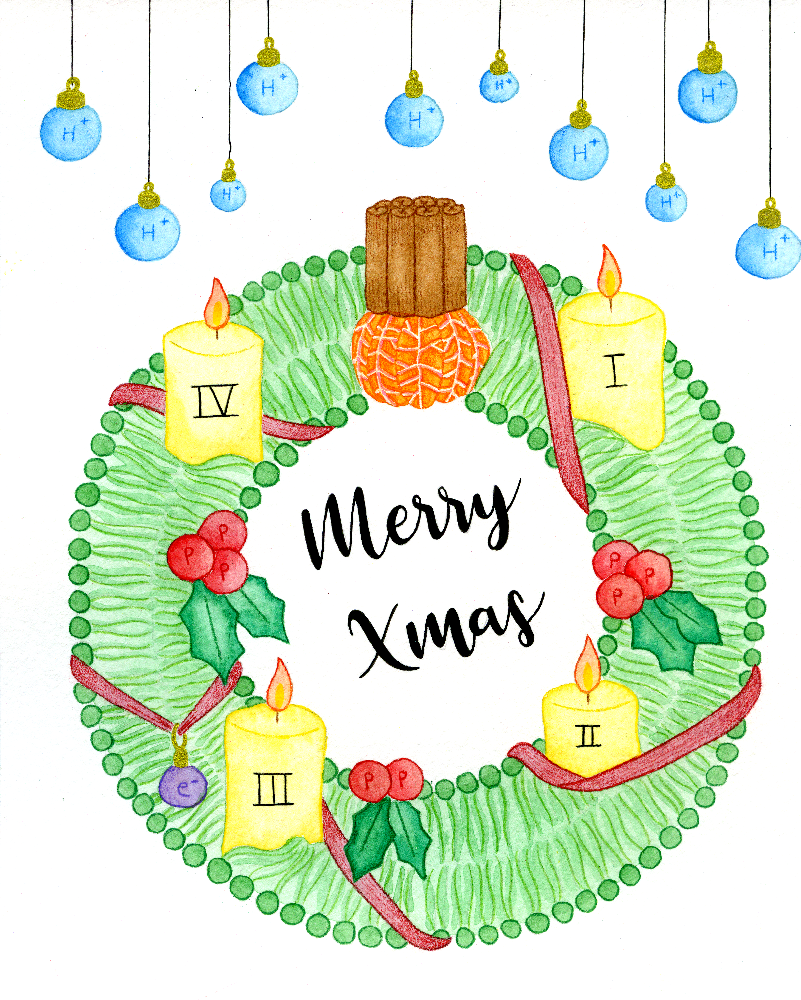
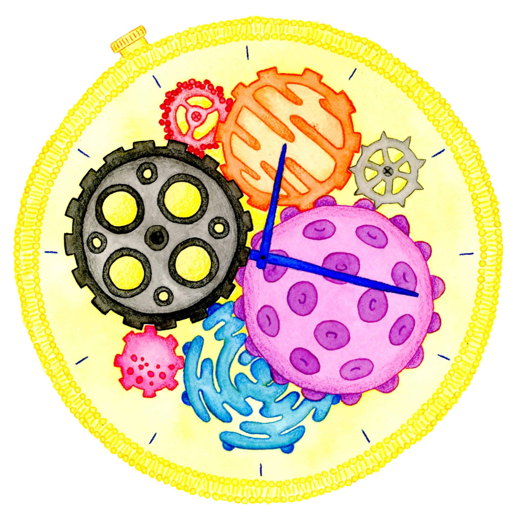

I strongly believe that doing good science is just as important as sharing it with the public. As a science communicator, I experiment with different formats to share scientific knowledge.

## Workshops for kids

This is the format I started with as a student at the [University of Pavia](https://en.unipv.it/en), demonstrating experiments about the human body at [Indiscienza](https://www.instagram.com/indiscienza/), a student-organized science fair. Later, I came back to this format by organizing workshops for Italian children in Germany with the association [Native Scientist](https://www.nativescientist.com/), and workshops in German for local children as part of the [KinderUni](https://kinderuni.uni-koeln.de/) at the University of Cologne.

## Talks

I have given talks about my research in many settings, from [Skype a Scientist](https://www.skypeascientist.com/) sessions to pub talks, and in different languages, from Italian to German. Below you can find videos of some of the science slams I took part in.<br>[Get in touch](contact.qmd) if you would like me to speak at your event!

```{=html}
<div class="video-gallery">

  <div class="video-tile">
    <iframe title="Science slam video 1" src="https://www.youtube.com/embed/xUwFYeNcl9o?si=7T0_nnl81HaNdWrq"
      allow="accelerometer; autoplay; clipboard-write; encrypted-media; gyroscope; picture-in-picture"
      allowfullscreen>
    </iframe>
  </div>
  
  <div class="video-tile">
    <iframe title="Science slam video 2" src="https://www.youtube.com/embed/-FFBiwrFrwg?si=RafmJWI7U_SyubiR"
      allow="accelerometer; autoplay; clipboard-write; encrypted-media; gyroscope; picture-in-picture"
      allowfullscreen>
    </iframe>
  </div>
  
  <div class="video-tile">
    <iframe title="Science slam video 3" src="https://www.youtube.com/embed/911BPimobVM?si=sKJA2AejObatw8Cp"
      allow="accelerometer; autoplay; clipboard-write; encrypted-media; gyroscope; picture-in-picture"
      allowfullscreen>
    </iframe>
  </div>
  
</div>
```

## Illustrations

Below you can find a selection of illustrations I have created for different projects, both with traditional media and digitally.<br>
[Get in touch](contact.qmd) if you are interested in a custom commission (graphical abstracts, logos, or visuals for websites and talks).

```{=html}
<div class="modular-gallery">

  <figure class="tile-wrap">
    
    <figcaption>Submitted cover art for <a href="https://www.nature.com/articles/s42255-025-01332-8" target="_blank" rel="noopener">Kaul et al. 2025</a></figcaption>
  </figure>

  <figure class="tile-wrap">
    
    <figcaption aria-hidden="true">Electron transport wreath for a mitochondria-themed Christmas postcard</figcaption>
  </figure>

  <figure class="tile-wrap rectangle">
    
    <figcaption aria-hidden="true">Mitochondria come in different shapes and flavors</figcaption>
  </figure>

  <figure class="tile-wrap">
    
    <figcaption aria-hidden="true">Poster for an activity sorting animals into diurnal, nocturnal and crepuscular species</figcaption>
  </figure>

  <figure class="tile-wrap">
    
    <figcaption aria-hidden="true">Watercolor reinterpretation of the cellular clock machinery</figcaption>
  </figure>

</div>
```

## Video

This was a one-off, but a lot of fun! Together with other science communication enthusiasts from the association [Indiscienza](https://www.instagram.com/indiscienza/), I made a stop-motion video (in Italian) about antibiotic resistance, which won the [Italian National Prize for Science Outreach](https://www.premiodivulgazionescientifica.it/la-quindicina-del-premio-nazionale-di-divulgazione-scientifica-2020/) in the category "Short videos".

```{=html}
<div class="video-single">
  <div class="video-tile">
    <iframe title="Stop-motion video on antibiotic resistance (in Italian)" src="https://www.youtube.com/embed/xVcE1aprsjQ?si=5Xhz4qdap8h73fvr"
      allow="accelerometer; autoplay; clipboard-write; encrypted-media; gyroscope; picture-in-picture"
      allowfullscreen>
    </iframe>
  </div>
</div>
```

<br><br>

::: {.license-note}
© Roberta Colapietro, 2026. All works on this page are licensed under a [Creative Commons Attribution-NonCommercial-NoDerivatives 4.0 International License](https://creativecommons.org/licenses/by-nc-nd/4.0/). <br> This means you're welcome to share anything from this page for non-commercial purposes, as long as you credit me as the creator and don't modify it!
:::

<div id="img-popup" class="img-popup d-none" role="status">
  <p>
    Want a high-res version or a custom illustration?<br>
    <a href="contact.qmd">Contact me here!</a>
  </p>
  <button type="button" class="close-popup" aria-label="Close">×</button>
</div>

<script>
  const popup = document.getElementById("img-popup");
  const closeBtn = document.querySelector(".close-popup");

  document.addEventListener("contextmenu", function(e) {
    if (e.target.tagName === "IMG") {
      e.preventDefault();
      popup.classList.remove("d-none");
    }
  });

  closeBtn.addEventListener("click", function() {
    popup.classList.add("d-none");
  });

  document.addEventListener("click", function(e) {
    if (!popup.contains(e.target)) {
      popup.classList.add("d-none");
    }
  });
</script>
