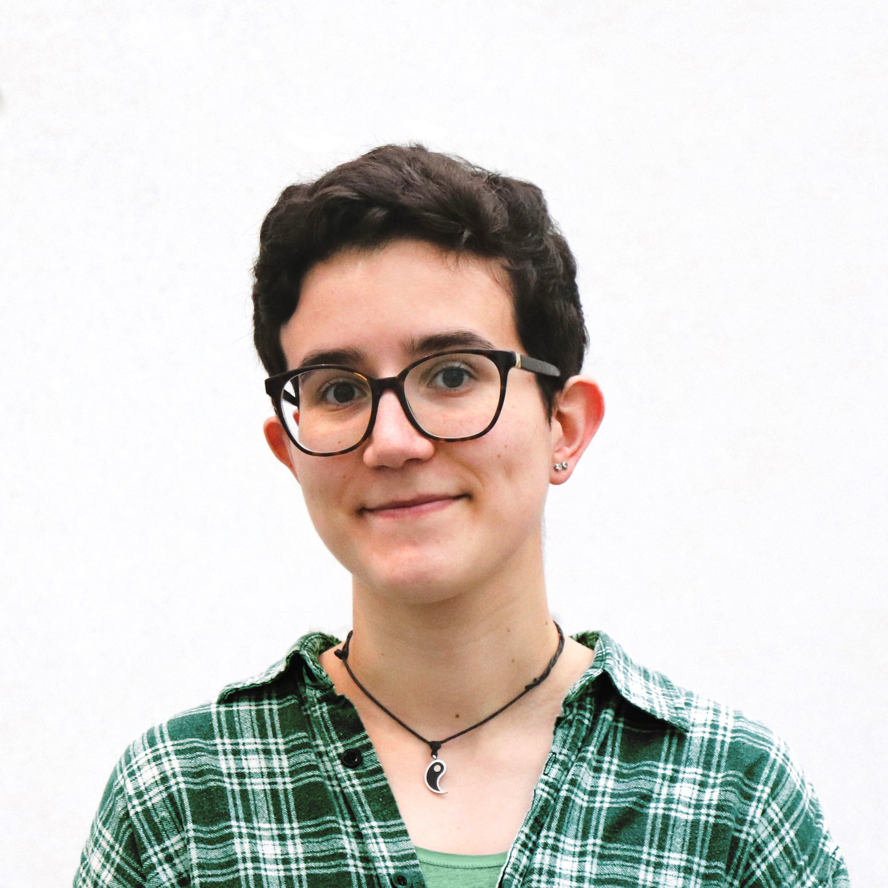

# Roberta Colapietro

 

I am a PhD student at the [Charité Medical University](https://www.charite.de/en/) where I explore how cells keep track of time in health and disease.   
I also love make this (and other) research topics accessible to the public through a variety of science outreach formats.    